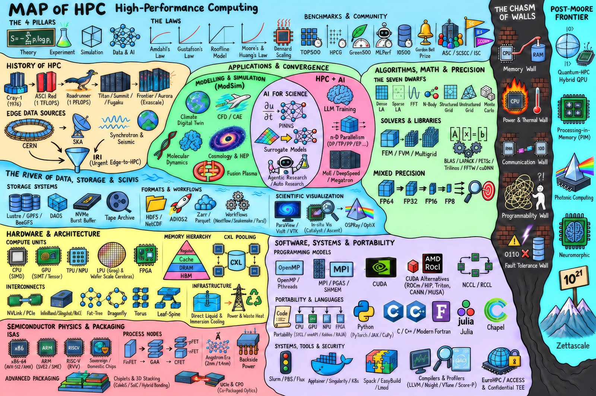

# ASC Team

We are HKUST's first student supercomputing team, learning high-performance computing together.

**Training:** Wednesdays, 18:30–20:00 (HKT)

**Contact:** hkustascteam@gmail.com

## Map of HPC

## Learning resources

[HPC Documentation](https://hkust-hpc-docs.readthedocs.io/latest/) is the official ITSO tutorials and knowledge base for HKUST central HPC; many techniques also apply elsewhere.

- [Linux](https://hkust-hpc-docs.readthedocs.io/latest/kb/linux/index.html)
- [Git and GitHub](https://hkust-hpc-docs.readthedocs.io/latest/kb/git/index.html)
- [How to Make a Pull Request](https://hkust-hpc-docs.readthedocs.io/latest/kb/git/how-to-make-a-pull-request.html)
